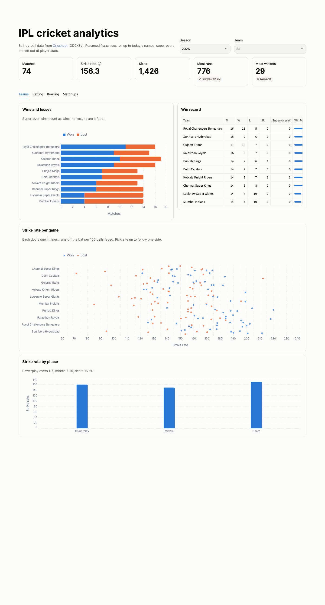

# IPL cricket analytics

A small lakehouse over every IPL match since 2008, ball by ball: wins and losses per team,
strike rate per game, batting and bowling leaderboards, strike rate by phase and
batter-v-bowler matchups. Runs locally on DuckDB and in AWS on Lambda, S3, Glue and Athena.



## Pipeline

```
Cricsheet ipl_json.zip ─▶ bronze (raw JSON per match) ─▶ silver (Parquet) ─▶ dbt ─▶ marts ─▶ Streamlit
```

| Layer | What it holds |
| --- | --- |
| Bronze | One JSON file per match, as published, partitioned by season. Re-runs write only new or revised matches. |
| Silver | Five typed tables: matches, innings, deliveries (295k rows), wickets, players. |
| Marts | `mart_team_season_results`, `mart_team_match_batting`, `mart_batter_innings`, `mart_batter_season`, `mart_bowler_season`, `mart_phase_strike_rates`, `mart_matchups`. |

The scoring rules (balls faced, bowler's runs, which wickets the bowler gets, phases, how
super overs and renamed franchises are handled) are in [docs/metrics.md](docs/metrics.md).
They're checked against published records: Kohli's 973 runs in 2016, Bravo's 32 wickets in 2013,
and every final from 2008 to 2026.

## Run it locally

```bash
make install
make ingest      # downloads ~5 MB from Cricsheet
make gold        # silver + dbt build on DuckDB, with tests
make dashboard   # http://127.0.0.1:8501
```

## AWS

Terraform in `infra/` creates a private S3 lake, Glue tables with partition projection, an
Athena workgroup capped at 1 GB per query, one Lambda container image with three handlers,
and a Step Functions state machine (ingest → silver → dbt on Athena) that runs daily. Failures
email via SNS, and a budget alert watches spend.

```bash
make tf-plan IMAGE_TAG=   # first apply: storage, catalog, ECR
make tf-apply
make image-push && make tf-plan && make tf-apply
make bronze-upload && make pipeline-run
```

## Data

Match data from [Cricsheet](https://cricsheet.org), licensed under the
[Open Data Commons Attribution License](https://opendatacommons.org/licenses/by/1-0/).
The repo holds no Cricsheet data; tests use invented matches.

## Next

- Win probability per ball (second innings: runs needed, balls left, wickets in hand).
- Match reports and "turning point" stories generated with Amazon Bedrock from the marts.
